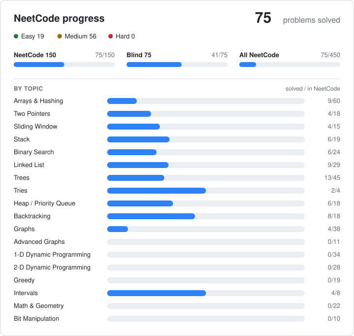

# NeetCode Grind

Hi there! This is where I solve [NeetCode](https://neetcode.io/) problems, one problem at a time. 

I'm using it to sharpen my problem-solving for interviews, and I'm slowly making peace with Dynamic Programming.

Let's grind! 💪

<!-- PROGRESS:START -->
### 📊 Progress

**75 problems solved** · 🟢 Easy 19 · 🟡 Medium 56 · 🔴 Hard 0

NeetCode 150 75/150 · Blind 75 41/75 · All NeetCode 75/450

Auto-updated on every push by `scripts/update_progress.py`.
<!-- PROGRESS:END -->
